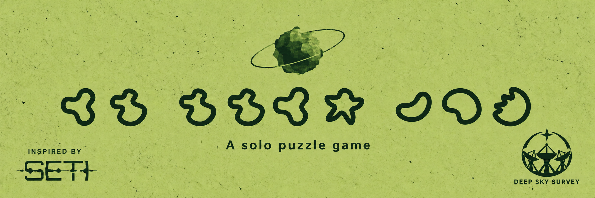

# Glypyids

[Play in your browser](https://glyphids.ender-wiggin.com/) · [简体中文](README.zh-CN.md)



**Across the dark, someone is listening.**

A short solo puzzle game inspired by SETI. At a Deep Sky Survey station in 2147, you receive a repeating signal. Study its pictures, annotate unfamiliar symbols, and find the words to write back.

About **one hour**, in **English or Chinese**. No SETI experience needed.

- Work inside a simulated desktop with mail, a data analyzer, dictionary, calculator, star chart, and notes.
- Follow the clues at your own pace, with optional hints and local saves.
- Play on desktop or mobile, then keep an image of your first contact.

> **Spoiler note:** the game draws on an alien species from *SETI: Space Agencies*. Playing may reveal part of that expansion's discovery experience.

## Credits

| Role | Credit |
| --- | --- |
| Created by | **ender** |
| Design | **ccc** |
| Inspiration | **SETI** |
| Special thanks for playtesting | **tonycxl** |

An independent fan game, not an official CGE release. SETI artwork and marks belong to their respective owners.

## Repository

This is the static release archive. `dist/` contains the playable build; [posts/](posts/README.md) contains platform copy, English and Chinese artwork, and a Chinese development article. Development source and credentials are not included.

To run locally:

```sh
python3 -m http.server 8080 --directory dist
```

Open [localhost:8080](http://localhost:8080). Saves belong to the current browser and site address; export them in Settings before changing devices or clearing browser data.

The live site uses Cloudflare Workers Static Assets. GitHub pushes alone do not deploy it. When updating `dist/`, retain previous hashed JavaScript and CSS so open tabs can still load their apps.

[Buy me a coffee](https://buymeacoffee.com/enderwiggin)
