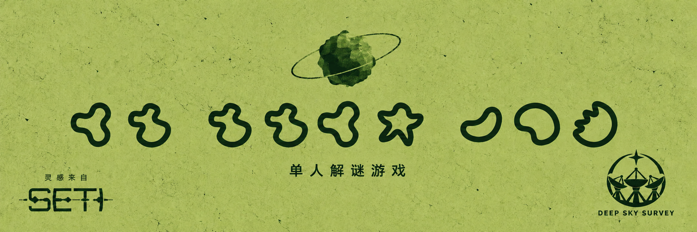

# Glypyids

[在线游玩](https://glyphids.ender-wiggin.com/) · [English](README.md)



**黑暗的另一端，有人在听。**

一款受 SETI 启发的单人解谜游戏。2147 年，你在深空巡天接收站收到一段重复信号。看图、标注陌生字符，慢慢找到写回去的话。

约 **1 小时**，支持 **中文和英文**。没玩过 SETI，也能开始这场邂逅。

- 在模拟电脑中使用邮件、数据分析器、词典、计算器、星图、百科全书和记事本。
- 按自己的节奏破译，提供可选提示与本地存档。
- 支持电脑和手机，完成后可保存第一次接触的纪念图。

> **剧透提醒：**游戏借用了《SETI: Space Agencies》中的一种外星生物。若想在扩展中亲自发现它们，建议谨慎游玩。

## 制作与致谢

| 职责 | 名字 |
| --- | --- |
| 作者 | **ender** |
| 设计师 | **ccc** |
| 灵感来源 | **SETI** |
| 特别感谢测试成员 | **tonycxl** |

独立同人作品，非 CGE 官方产品。SETI 的美术与标志归各自权利人所有。

## 仓库

`dist/` 是静态游戏发布包；[posts/](posts/README.md) 收录各平台短文案、中英文图片与中文开发文章。仓库不包含开发源码和凭据。

本地运行：

```sh
python3 -m http.server 8080 --directory dist
```

打开 [localhost:8080](http://localhost:8080)。存档保存在当前浏览器和站点地址下；换设备或清理浏览器前，请在设置中导出。

线上站点使用 Cloudflare Workers Static Assets，推送 GitHub 不会自动部署。更新发布包时需保留旧版哈希脚本与样式，供尚未刷新的页面继续加载应用。

[请我喝杯咖啡](https://buymeacoffee.com/enderwiggin)
