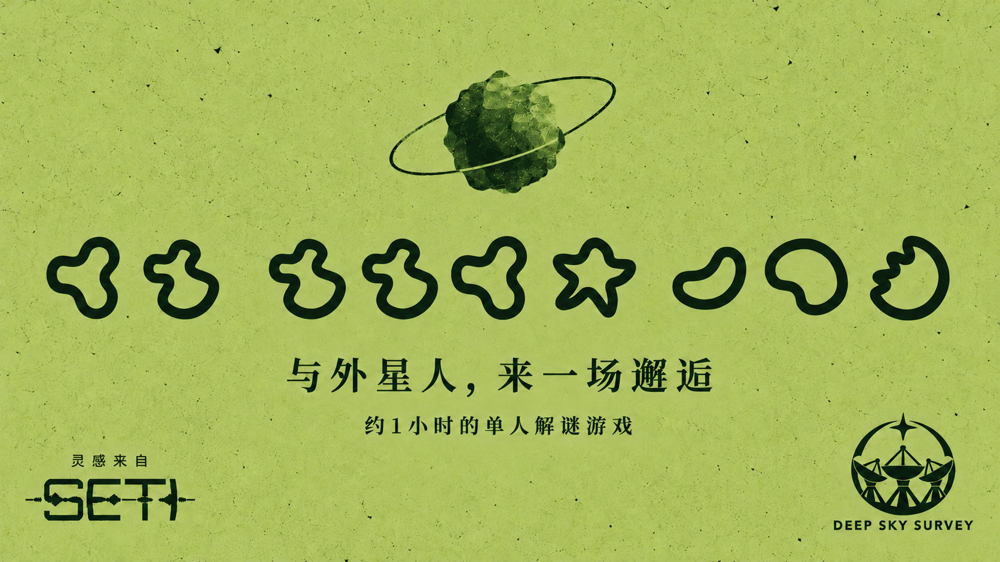

如果收到一段外星信号，我们会从哪里开始理解它？受桌游《SETI》启发，我做了一个约一小时的单人浏览器解谜游戏：**Glypyids**。没玩过 SETI，也可以直接开始。

游戏地址：[https://glyphids.ender-wiggin.com/](https://glyphids.ender-wiggin.com/)

## 背景

这是一款受 SETI 中外星生物启发的同人解谜游戏。你会坐在 Deep Sky Survey 的工作电脑前，阅读收到的图像，为线索写下自己的注释，把反复出现的图形逐步解码，再把理解写回一封发往深空的回信。电脑里还放着词典、计算器、星图、数据分析器等工具，它们不是单独的展示，而是解谜过程的一部分。

游戏涉及《SETI: Space Agencies》的外星生物内容，想在桌游中亲自发现它们的朋友请留意。下面只聊制作，不展示答案和结局。

## 设计

原始卡牌最吸引我的地方，是那些精确的字形、轨道和分子结构。实现时我没有把它们合并成一张静态插图，而是拆成可以组合、标注和复用的 SVG 图层：字形、数量、分子、轨道几何与注释各自独立，既保留了科学图表的感觉，也让玩家的观察真正成为游戏状态。

界面围绕一台研究电脑展开，邮件、新闻和工具都属于同一个桌面。共享的 SETI glyph 和图标资产继续复用，同时为这次故事补充了设定、邮件，以及新闻页面的插图和文字。这样它更像一台正在工作的设备，而不只是一个谜题菜单。

## 技术与制作时间

项目使用 React 18、TypeScript 和 Vite，文本编辑采用 Tiptap，界面提供中英文双语。存档全部保存在浏览器 localStorage，不需要账号；发布时是 Cloudflare Workers Assets 上的静态站点，没有游戏后端，也没有运行时 AI 或外部翻译服务。

从 10 月 28 日开始，到 10 月 30 日整理这版发布内容，包含反复的设计、实现和测试，大约用了 2—3 天。这里指的是日历时间，不是精确统计过的净工作时长。开发和部分美术制作有 AI 辅助，但游戏中的图形规则、存档和解谜流程都由代码明确实现。

## 致谢

作者：ender；设计：ccc；灵感来源：SETI；特别感谢测试：tonycxl。

如果你愿意花一点时间读图、做注释、解码，最后把自己的答案写回去，欢迎来试试 Glypyids。
